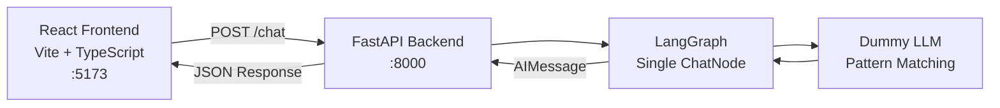

# AMICA — AI-Powered Personal Life Assistant

## ✅ Project Setup Complete

Both the **frontend** and **backend** are built and running.

---

## Screenshots

### Welcome Screen


### Chat in Action


---

## Architecture



## Color Palette (Sci-Fi HUD)

| Token | Hex | Usage |
|-------|-----|-------|
| `--hud-dark` | `#171f22` | Deepest background |
| `--hud-steel` | `#636467` | Muted steel / borders |
| `--hud-olive` | `#666b64` | Olive accent |
| `--hud-slate` | `#748b91` | Secondary text |
| `--hud-ice` | `#c1d1cf` | Primary text & glows |

## Project Structure

```
Amica/
├── backend/
│   ├── requirements.txt          # Python dependencies
│   └── server/
│       ├── agent.py              # LangGraph agent (single ChatNode + dummy LLM)
│       └── main.py               # FastAPI server with /chat endpoint
└── frontend/
    ├── package.json
    ├── index.html                # Entry HTML with Sci-Fi fonts
    ├── public/
    │   └── favicon.svg
    └── src/
        ├── style.css             # Full HUD design system
        └── main.ts               # Application logic & rendering
```

## Running the App

### Backend (FastAPI)
```bash
cd backend/server
python -m uvicorn main:app --host 0.0.0.0 --port 8000 --reload
```

### Frontend (Vite)
```bash
cd frontend
npm run dev
```

| Service | URL |
|---------|-----|
| Frontend | [http://localhost:5173](http://localhost:5173) |
| Backend API | [http://localhost:8000](http://localhost:8000) |
| API Docs | [http://localhost:8000/docs](http://localhost:8000/docs) |

## Key Files

| File | Purpose |
|------|---------|
| [`agent.py`](file:///d:/major_project/Amica/backend/server/agent.py) | LangGraph with single `chat_node` + pattern-matching dummy LLM |
| [`main.py`](file:///d:/major_project/Amica/backend/server/main.py) | FastAPI server — `/chat` POST, `/health` GET |
| [`main.ts`](file:///d:/major_project/Amica/frontend/src/main.ts) | Full app rendering, chat logic, API calls |
| [`style.css`](file:///d:/major_project/Amica/frontend/src/style.css) | Sci-Fi HUD design system with scanlines, grid, vignette |

> [!TIP]
> To swap in a real LLM, replace the `_generate_dummy_response()` function in `agent.py` with an actual LangChain LLM call (e.g., `ChatOpenAI`, `ChatGoogleGenerativeAI`). The graph structure stays the same.
