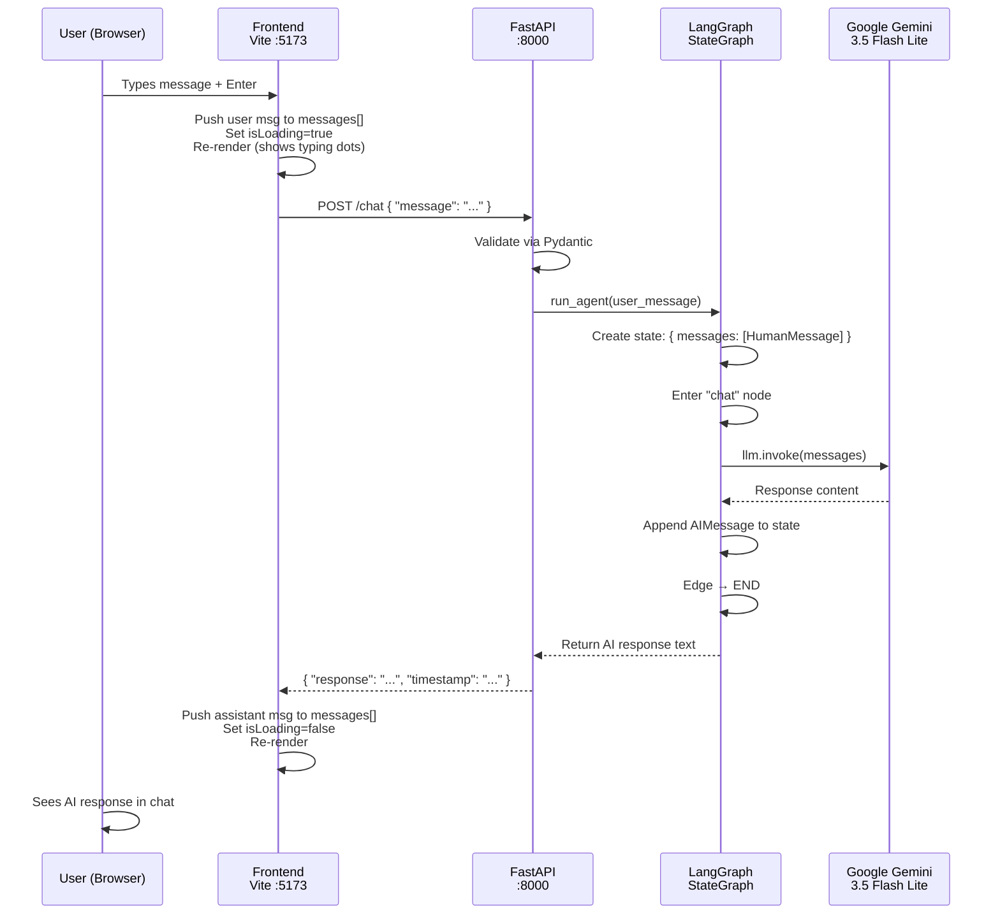

# AMICA — Complete Project Deep Dive

## 1. What is Amica?

**Amica** is an **AI-powered personal life assistant** — a full-stack chat application with a futuristic **Sci-Fi HUD (Heads-Up Display)** interface. Users send natural-language messages through a chat UI, and the backend processes them using a **LangGraph agent** backed by **Google Gemini AI** (`gemini-3.5-flash-lite`).

Think of it as a personal ChatGPT-like assistant with a custom cyberpunk aesthetic.

---

## 2. Tech Stack

### Frontend
| Technology | Role |
|---|---|
| **TypeScript** | Application logic (vanilla — no framework like React/Vue) |
| **Vite 8.3** | Build tool & dev server (HMR, bundling, TS transpilation) |
| **Vanilla CSS** | 627-line hand-crafted Sci-Fi HUD design system |
| **Google Fonts** | Orbitron (display), Rajdhani (body), Share Tech Mono (monospace) |

### Backend
| Technology | Role |
|---|---|
| **Python** | Language |
| **FastAPI 0.115** | REST API framework |
| **Uvicorn 0.30** | ASGI server for FastAPI |
| **LangGraph 0.2.20** | Stateful agent graph orchestrator |
| **LangChain Core 0.3.1** | Message primitives (`HumanMessage`, `AIMessage`) |
| **`langchain-google-genai`** | Google Gemini LLM integration |
| **Pydantic 2.9** | Request/response validation |
| **python-dotenv** | `.env` file loading for API keys |

### Infrastructure
| Component | Detail |
|---|---|
| **API Key** | Gemini API key stored in [`backend/.env`](file:///d:/major_project/Amica/backend/.env) |
| **Virtual Environment** | `backend/myenv/` (Python venv) |
| **Version Control** | Git |

---

## 3. Project Structure

```
Amica/
├── amica_summary.md               # Project documentation/readme
├── backend/
│   ├── .env                        # GEMINI_API_KEY=...
│   ├── .gitignore
│   ├── requirements.txt            # Python deps (6 packages)
│   ├── myenv/                      # Python virtual environment
│   └── server/
│       ├── agent.py                # LangGraph agent + Gemini LLM
│       └── main.py                 # FastAPI REST server
└── frontend/
    ├── index.html                  # Entry HTML (fonts, meta, app div)
    ├── package.json                # Vite + TypeScript config
    ├── tsconfig.json               # TS compiler options (ES2023, bundler)
    ├── public/
    │   ├── favicon.svg             # Browser tab icon
    │   └── icons.svg               # SVG icon sprite
    └── src/
        ├── main.ts                 # ALL app logic (343 lines)
        └── style.css               # Full HUD design system (627 lines)
```

---

## 4. Architecture & Data Flow



---

## 5. File-by-File Breakdown

### Backend

#### [`agent.py`](file:///d:/major_project/Amica/backend/server/agent.py) — The Brain

This is the AI core. Here's what happens step by step:

1. **State Definition** (line 20-22): Defines `AgentState` — a TypedDict with a single field `messages` (a list of LangChain `BaseMessage` objects). The `operator.add` annotation tells LangGraph to *append* new messages rather than replace.

2. **LLM Initialization** (line 30): Creates a `ChatGoogleGenerativeAI` instance pointing to `gemini-3.5-flash-lite`. The API key is loaded from `.env` via `load_dotenv()`.

3. **Chat Node** (line 36-47): The single processing node in the graph. It:
   - Receives the full message list from state
   - Calls `llm.invoke(messages)` to get Gemini's response
   - Extracts the text from `response.content[0]['text']`
   - Returns it wrapped as an `AIMessage`

4. **Graph Construction** (line 53-65):
   ```
   START → chat_node → END
   ```
   A minimal single-node LangGraph. The `StateGraph` is compiled into a runnable graph.

5. **`run_agent()`** (line 72-84): The public API function. Takes a string, wraps it as `HumanMessage`, runs the graph, and extracts the last `AIMessage` content as a plain string.

#### [`main.py`](file:///d:/major_project/Amica/backend/server/main.py) — The HTTP Layer

1. **FastAPI App** (line 16-20): Creates the app with metadata (title, description, version).

2. **CORS Middleware** (line 23-29): Allows **all origins** (`*`) — necessary because the frontend at `:5173` talks to the backend at `:8000` (cross-origin).

3. **Pydantic Models** (line 35-41):
   - `ChatRequest`: `{ message: str }`
   - `ChatResponse`: `{ response: str, timestamp: str }`

4. **Routes**:
   | Method | Path | Purpose |
   |--------|------|---------|
   | `GET` | `/` | Returns API info JSON |
   | `GET` | `/health` | Health check with timestamp |
   | `POST` | `/chat` | Main endpoint — takes a message, runs the agent, returns response |

5. **Error Handling**: Empty messages get a `400`, agent failures get a `500`.

---

### Frontend

#### [`index.html`](file:///d:/major_project/Amica/frontend/index.html) — Entry Point

- Loads 3 Google Fonts: **Orbitron**, **Rajdhani**, **Share Tech Mono**
- Sets up the `<div id="app">` mount point
- Loads [`main.ts`](file:///d:/major_project/Amica/frontend/src/main.ts) as an ES module (Vite handles the TS → JS transpilation)

#### [`main.ts`](file:///d:/major_project/Amica/frontend/src/main.ts) — Application Logic (343 lines)

> [!IMPORTANT]
> This is a **frameworkless** app — no React, no Vue. All rendering is done via `innerHTML` string templates, and re-rendering replaces the entire DOM on every state change.

**Key sections:**

1. **Configuration** (line 6): `API_BASE = 'http://localhost:8000'`

2. **SVG Icons** (lines 11-40): Inline SVG icons defined as template strings (logo, send, chat, tasks, calendar, memory, settings, welcome icon).

3. **State** (lines 44-52):
   ```typescript
   interface ChatMessage {
     role: 'user' | 'assistant';
     content: string;
     timestamp: string;
   }
   let messages: ChatMessage[] = [];
   let isLoading = false;
   ```
   Simple in-memory state — **no persistence**. Messages are lost on refresh.

4. **API Layer** (lines 76-96): `sendMessage()` — POSTs to `/chat`, returns the response string. Falls back to an error message if the backend is unreachable.

5. **Rendering** (lines 101-250):
   - `renderApp()`: Builds the entire page HTML — header, sidebar, chat area, input
   - `renderWelcome()`: Shows when `messages.length === 0` — displays a floating icon, welcome text, and 4 quick-start chips
   - `renderMessages()`: Renders all chat messages + a typing indicator when `isLoading` is true

6. **Event Binding** (lines 255-292):
   - Enter key → send message
   - Send button click → send message
   - Welcome chips → pre-fill and send a prompt
   - Sidebar items → visual toggle (only chat is functional)

7. **Chat Flow** (`handleSend`, lines 294-322):
   ```
   User types → push user message → set isLoading → re-render (typing dots) 
     → await API → push assistant message → clear isLoading → re-render
   ```

8. **Clock** (lines 334-337): Updates the header clock every second.

9. **Boot** (line 342): Calls `renderApp()` once to start the app.

#### [`style.css`](file:///d:/major_project/Amica/frontend/src/style.css) — Design System (627 lines)

A fully custom **Sci-Fi HUD aesthetic** with these visual layers:

| Layer | Description |
|-------|-------------|
| **Scanline overlay** | Subtle horizontal scan lines across the entire viewport |
| **Grid background** | Faint graph-paper grid pattern |
| **Vignette** | Darkened edges via radial gradient |
| **HUD corners** | L-shaped bracket decorations at each viewport corner |

**Color Palette (CSS Custom Properties):**

| Token | Value | Purpose |
|-------|-------|---------|
| `--hud-dark` | `#171f22` | Deepest background |
| `--hud-dark-alt` | `#1c2528` | Slightly lighter background |
| `--hud-steel` | `#7d8084` | Muted steel / borders |
| `--hud-olive` | `#788d7a` | Olive accent (user messages) |
| `--hud-slate` | `#8fa6ac` | Secondary text |
| `--hud-ice` | `#d6e4e2` | Primary text & glows |
| `--hud-accent` | `#a3bfbd` | Highlights, status dot |
| `--hud-danger` | `#a05050` | Error/danger (defined but unused) |

**Typography:**
- **Orbitron** — Display headings (futuristic, geometric)
- **Rajdhani** — Body text (clean, modern)
- **Share Tech Mono** — Monospace labels, timestamps, hints

**Animations:**
| Animation | Effect |
|-----------|--------|
| `pulse-dot` | Status dot glow pulsing |
| `message-in` | Messages slide up + fade in |
| `typing-bounce` | Three dots bouncing sequentially |
| `float` | Welcome icon floating up and down |

**Responsive:** Sidebar hides on screens ≤ 768px, padding/font sizes adjust.

---

## 6. How to Run

### Backend
```bash
cd backend/server
python -m uvicorn main:app --host 0.0.0.0 --port 8000 --reload
```

### Frontend
```bash
cd frontend
npm run dev
```

| Service | URL |
|---------|-----|
| Frontend | `http://localhost:5173` |
| Backend API | `http://localhost:8000` |
| Swagger Docs | `http://localhost:8000/docs` |

---

## 7. Current Limitations & What's Placeholder

| Feature | Status |
|---------|--------|
| **Chat** | ✅ Fully functional (Gemini-powered) |
| **Tasks sidebar** | ❌ Visual only — clicking highlights it but has no panel |
| **Schedule sidebar** | ❌ Visual only |
| **Memory sidebar** | ❌ Visual only |
| **Settings sidebar** | ❌ Visual only |
| **Chat persistence** | ❌ Messages stored in-memory only, lost on refresh |
| **Conversation history** | ❌ Only the latest user message is sent to the LLM (no multi-turn context on the backend — the graph re-creates state each call) |
| **Authentication** | ❌ None |
| **Error UI** | ⚠️ Fallback text only, no visual error states |

---

## 8. Key Architectural Decisions

1. **Frameworkless Frontend**: Uses vanilla TypeScript with `innerHTML` re-rendering. Simple but not scalable — every state change reconstructs the entire DOM.

2. **LangGraph (even for a single node)**: The agent graph is `START → chat → END`. LangGraph is overkill for this, but it sets up the **infrastructure** to easily add tool nodes, memory nodes, or routing logic later.

3. **Stateless Backend**: Each `/chat` call creates a fresh `AgentState`. The conversation history is **not** carried across calls — the LLM only sees the current message, not previous ones.

4. **CORS Allow-All**: `allow_origins=["*"]` is fine for development but should be locked down for production.

5. **Gemini API Key in `.env`**: Loaded via `python-dotenv`. The key is a raw Google API key stored in plaintext.
